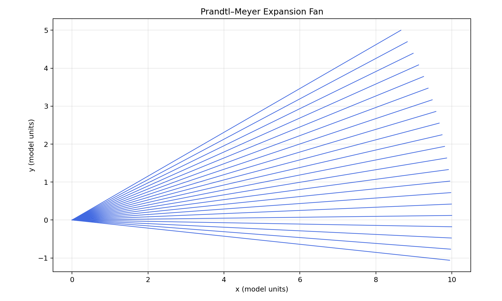

# Basic characteristic fan
Developed by **Tyler Warner**

This is a reconstructed functional snapshot of an earlier stage developed in the conversation.
It is not an original Git checkout or an exact copy of unshared local edits.
Minor packaging and input-validation changes make the snapshot runnable on its own.

Sequential C++ calculates Mach states and straight characteristic rays. Python plots the exported coordinates. Pressure, temperature, OpenMP, and streamlines are absent.

Both snapshots use the same demonstration inputs: Mach 2, 25° expansion, 200 kPa
absolute static pressure where applicable, 300 K static temperature where applicable,
gamma 1.4, and a ray length of 10 model units.

From this folder, compile and run:

~~~powershell
g++ -O2 -std=c++17 characteristicSolver.cpp -o characteristicSolver.exe
.\characteristicSolver.exe
python plot_characteristics.py
~~~

Run C++ from this folder so its CSV is saved beside the plotting script.
Install NumPy and Matplotlib in the selected Python environment first.

## Author

**Tyler Warner**  
Mechanical Engineering Student — University of Connecticut

Developed as a personal engineering project exploring Prandtl–Meyer expansion fans, numerical methods, OpenMP parallelization, and scientific visualization.

[GitHub](https://github.com/warnerty)

## Example output

